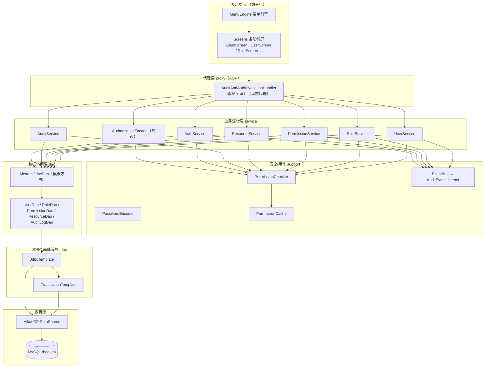
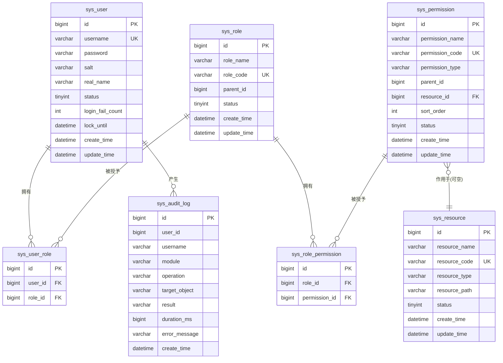
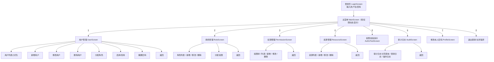
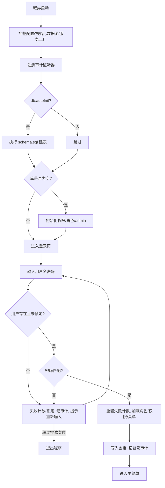
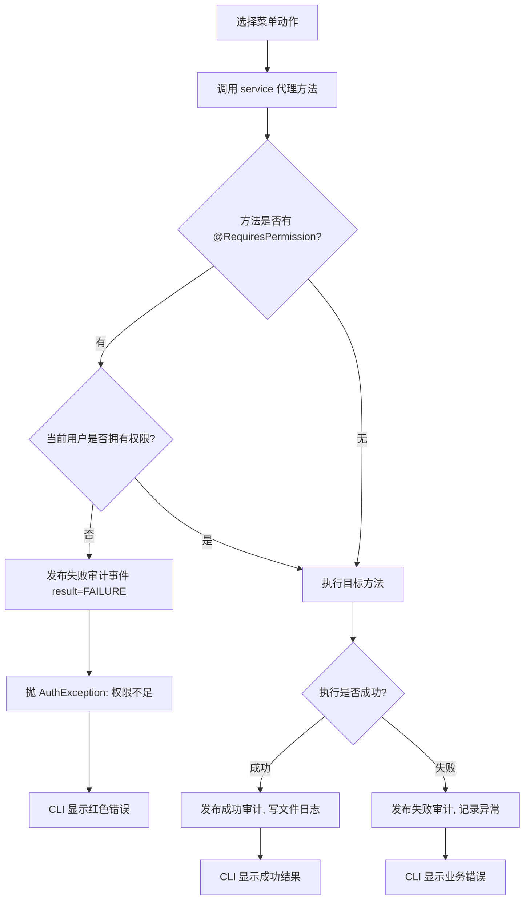

# 基于命令行的 RBAC 权限管理系统 —— 开发计划与实现规范（Codex 任务书）

> 本文档是交给 **Codex** 的唯一开发规格，分为两部分：
> - **第一部分 PLAN（项目规划）**：讲清楚“做成什么样、怎么设计”。
> - **第二部分 IMPLEMENT（实现任务书）**：讲清楚“每个类怎么写、分几步做、如何验收”。
>
> Codex 请严格按本文档实现，**不要引入 Spring / Spring Boot**（本项目用纯 JDBC + 手写分层与动态代理，目的是体现面向对象、设计模式和 JDBC 基础能力）。代码需有清晰中文注释。

---

# 第一部分：PLAN（项目规划）

## 1. 项目背景与目标

### 1.1 项目目标
开发一个**基于命令行（CLI）的权限管理系统**，深入实践 RBAC（Role-Based Access Control，基于角色的访问控制）模型，实现“**用户 — 角色 — 权限**”三层映射，并将权限作用到“**资源**”上。

### 1.2 必须达成的能力
1. 掌握 Java 面向对象编程：继承、多态、抽象类、接口、注解、Lambda、泛型、内部类、集合框架。
2. 使用 **JDBC** 完成数据持久化（含连接池、事务、防 SQL 注入）。
3. 使用日志组件（SLF4J + Logback）记录程序运行情况并输出到文件。
4. 构建**分区清晰、菜单导航、反馈明确**的命令行交互界面。
5. 使用**分层架构**和多种**设计模式**，类职责单一、结构清晰。
6. 实现权限校验、权限审计，并具备若干特色/扩展功能。

### 1.3 实体范围
- 核心实体：**用户（User）、角色（Role）、权限（Permission）、资源（Resource）**。
- 关系实体：用户-角色（UserRole）、角色-权限（RolePermission）。
- 审计实体：审计日志（AuditLog）。
- 其他辅助类（DTO/VO/工具类等）自行按本文档补齐。

---

## 2. 技术栈与依赖

| 类别 | 选型 | 说明 |
|---|---|---|
| JDK | **JDK 17**（兼容 11+，不使用高版本“独有”语法，保证 17 可编译） | 提供 Lambda、Stream、泛型、函数式接口 |
| 构建工具 | **Maven 3.8+** | 依赖管理与打包 |
| 数据库 | **MySQL 8.x** | 数据库名 `rbac_db`，字符集 utf8mb4 |
| JDBC 驱动 | `com.mysql:mysql-connector-j:8.4.0` | |
| 连接池 | `com.zaxxer:HikariCP:5.1.0` | 企业级连接池 |
| 日志门面 | `org.slf4j:slf4j-api:2.0.13` | |
| 日志实现 | `ch.qos.logback:logback-classic:1.5.6` | 控制台 + 滚动文件 |
| 密码加密 | JDK 自带 `PBKDF2WithHmacSHA256` | 不额外引依赖，加盐哈希 |
| 命令行彩色 | 自封装 ANSI 转义工具 | 现代终端 / IDEA 控制台支持 |

> 不使用 Lombok：所有 getter/setter/构造器手写（或对纯数据载体使用 `record`，但实体类建议用普通类以便继承 `BaseEntity`）。

---

## 3. 项目目录结构

工程根目录名：`rbac-cli`。

```
rbac-cli/
├── pom.xml
├── README.md
├── sql/
│   ├── schema.sql                 # 建表脚本（幂等 CREATE TABLE IF NOT EXISTS）
│   └── data.sql                   # 可选：手工初始化参考（默认由 DataInitializer 自动初始化）
├── logs/                          # 运行时自动生成日志文件（提交 .gitkeep）
└── src/main/
    ├── resources/
    │   ├── db.properties          # 数据库与连接池配置
    │   ├── logback.xml            # 日志配置
    │   └── schema.sql             # 与 sql/schema.sql 保持一致，供程序自动建表
    └── java/com/cqu/rbac/
        ├── Main.java                                  # 程序入口
        ├── config/
        │   ├── ConfigManager.java                     # 配置加载（单例）
        │   └── DataSourceManager.java                 # HikariCP 数据源（单例）
        ├── common/
        │   ├── constants/Constants.java
        │   ├── enums/
        │   │   ├── PermissionType.java                # MENU / OPERATION / RESOURCE
        │   │   ├── ResourceType.java                  # MENU / FILE / API / DATA
        │   │   ├── CommonStatus.java                  # ENABLED / DISABLED
        │   │   ├── OperationResult.java               # SUCCESS / FAILURE
        │   │   └── Logical.java                       # AND / OR（权限组合逻辑）
        │   ├── exception/
        │   │   ├── BusinessException.java
        │   │   ├── AuthException.java
        │   │   ├── DaoException.java
        │   │   └── GlobalExceptionHandler.java
        │   ├── result/
        │   │   ├── Result.java                        # 统一返回体 Result<T>（泛型）
        │   │   ├── PageResult.java                    # 分页结果（泛型）
        │   │   └── PageQuery.java                     # 分页参数
        │   └── annotation/
        │       ├── RequiresPermission.java            # 方法权限注解
        │       └── AuditLog.java                      # 方法审计注解
        ├── domain/
        │   ├── entity/
        │   │   ├── BaseEntity.java
        │   │   ├── User.java
        │   │   ├── Role.java
        │   │   ├── Permission.java
        │   │   ├── Resource.java
        │   │   └── AuditLog.java
        │   ├── dto/
        │   │   ├── LoginDTO.java
        │   │   ├── UserDTO.java
        │   │   ├── RoleDTO.java
        │   │   ├── ChangePasswordDTO.java
        │   │   └── IdListDTO.java                     # 分配角色/权限的 id 列表
        │   └── vo/
        │       ├── LoginUser.java                     # 登录后会话用户（含权限码集合）
        │       ├── MenuNode.java                      # 菜单树节点
        │       ├── PermissionNode.java                # 权限树节点
        │       └── UserVO.java                        # 用户列表展示（含角色名）
        ├── jdbc/
        │   ├── JdbcTemplate.java                      # 自封装 JDBC 模板（核心）
        │   ├── RowMapper.java                         # 函数式接口（泛型）
        │   ├── PreparedStatementSetter.java
        │   ├── KeyHolder.java                         # 回填自增主键
        │   └── TransactionTemplate.java               # 编程式事务（ThreadLocal 绑定连接）
        ├── dao/
        │   ├── BaseDao.java                           # 泛型 CRUD 接口
        │   ├── impl/
        │   │   └── AbstractJdbcDao.java               # 模板方法：通用 CRUD
        │   ├── UserDao.java
        │   ├── RoleDao.java
        │   ├── PermissionDao.java
        │   ├── ResourceDao.java
        │   ├── AuditLogDao.java
        │   └── impl/
        │       ├── UserDaoImpl.java
        │       ├── RoleDaoImpl.java
        │       ├── PermissionDaoImpl.java
        │       ├── ResourceDaoImpl.java
        │       └── AuditLogDaoImpl.java
        ├── security/
        │   ├── PasswordEncoder.java                   # 接口
        │   ├── Pbkdf2PasswordEncoder.java             # 实现（单例）
        │   ├── PermissionCache.java                   # 权限缓存（特色）
        │   └── PermissionChecker.java                 # 权限判定（供代理调用）
        ├── event/
        │   ├── AuditEvent.java
        │   ├── EventListener.java                     # 监听器接口
        │   ├── EventBus.java                          # 事件总线（单例，观察者模式）
        │   └── AuditEventListener.java                # 审计事件落库
        ├── service/
        │   ├── UserService.java  (+ impl/UserServiceImpl.java)
        │   ├── RoleService.java  (+ impl/RoleServiceImpl.java)
        │   ├── PermissionService.java (+ impl/PermissionServiceImpl.java)
        │   ├── ResourceService.java (+ impl/ResourceServiceImpl.java)
        │   ├── AuditService.java (+ impl/AuditServiceImpl.java)
        │   └── AuthService.java  (+ impl/AuthServiceImpl.java)
        ├── support/
        │   ├── AuthorizationFacade.java               # 外观：统一鉴权/菜单/资源访问入口
        │   ├── DataInitializer.java                   # 首次启动自动建表 + 初始化数据
        │   └── ServiceLocator.java                    # 服务工厂（单例），返回“代理后的”服务
        ├── proxy/
        │   ├── ServiceProxyFactory.java               # JDK 动态代理工厂
        │   └── AuditAndAuthInvocationHandler.java     # 鉴权 + 审计统一拦截
        └── cli/
            ├── console/
            │   ├── AnsiColors.java                    # ANSI 颜色常量
            │   ├── ConsolePrinter.java                # 输出（彩色、分区、表格）
            │   └── ConsoleReader.java                 # 输入封装（读字符串/整数/确认）
            ├── session/
            │   └── SessionManager.java                # 当前登录会话（ThreadLocal/单例）
            ├── menu/
            │   ├── MenuItem.java                      # 菜单项（含 Lambda 动作，命令模式）
            │   ├── Menu.java
            │   └── MenuEngine.java                    # 菜单渲染与导航循环
            └── screens/
                ├── LoginScreen.java
                ├── MainScreen.java
                ├── UserScreen.java
                ├── RoleScreen.java
                ├── PermissionScreen.java
                ├── ResourceScreen.java
                ├── AuthzTestScreen.java               # 权限校验演示
                ├── AuditScreen.java
                └── ProfileScreen.java                 # 修改本人密码
```

---

## 4. 分层架构设计

### 4.1 架构分层（自上而下）



### 4.2 各层职责

| 层 | 包 | 职责 | 不允许做的事 |
|---|---|---|---|
| 表示层 | `cli` | 菜单渲染、读取输入、展示结果、捕获业务异常并友好提示 | 不直接写 SQL、不直接处理连接 |
| 代理层 | `proxy` | 拦截 service 方法，完成**权限校验**与**审计记录** | 不写业务逻辑 |
| 业务层 | `service` | 业务规则、事务边界、调用 DAO、发布事件、权限装配 | 不直接拼接/执行 SQL |
| 外观/支持 | `support` | 统一鉴权入口、服务工厂、数据初始化 | — |
| 安全/事件 | `security`、`event` | 密码加密、权限判定、缓存、事件发布与监听 | — |
| 数据访问层 | `dao` | 单表 CRUD、关系表维护、结果映射 | 不处理业务规则 |
| JDBC 层 | `jdbc` | 获取/释放连接、参数绑定、结果映射、事务、主键回填 | 不含业务语义 |
| 数据层 | MySQL | 持久化 | — |

**调用规则**：cli → 代理 → service → dao → jdbc → db。允许同层/向下调用，禁止 dao 反向依赖 service，禁止跨层混乱。

---

## 5. 数据库设计

### 5.1 ER 图



### 5.2 建表脚本 `schema.sql`（幂等）

```sql
-- 数据库（如未创建，请先执行）：
-- CREATE DATABASE IF NOT EXISTS rbac_db DEFAULT CHARACTER SET utf8mb4 COLLATE utf8mb4_general_ci;
-- USE rbac_db;

-- 用户表
CREATE TABLE IF NOT EXISTS sys_user (
    id               BIGINT       NOT NULL AUTO_INCREMENT COMMENT '主键',
    username         VARCHAR(50)  NOT NULL COMMENT '登录名',
    password         VARCHAR(200) NOT NULL COMMENT '密码（PBKDF2加盐哈希）',
    salt             VARCHAR(64)  NOT NULL COMMENT '盐值',
    real_name        VARCHAR(50)           DEFAULT NULL COMMENT '姓名',
    email            VARCHAR(100)          DEFAULT NULL COMMENT '邮箱',
    phone            VARCHAR(20)           DEFAULT NULL COMMENT '电话',
    status           TINYINT      NOT NULL DEFAULT 1 COMMENT '状态：1启用 0禁用',
    login_fail_count INT          NOT NULL DEFAULT 0 COMMENT '连续登录失败次数',
    lock_until       DATETIME              DEFAULT NULL COMMENT '锁定截止时间',
    create_time      DATETIME     NOT NULL DEFAULT CURRENT_TIMESTAMP,
    update_time      DATETIME     NOT NULL DEFAULT CURRENT_TIMESTAMP ON UPDATE CURRENT_TIMESTAMP,
    PRIMARY KEY (id),
    UNIQUE KEY uk_username (username)
) ENGINE = InnoDB DEFAULT CHARSET = utf8mb4 COMMENT ='用户表';

-- 角色表
CREATE TABLE IF NOT EXISTS sys_role (
    id          BIGINT      NOT NULL AUTO_INCREMENT,
    role_name   VARCHAR(50) NOT NULL COMMENT '角色名称',
    role_code   VARCHAR(50) NOT NULL COMMENT '角色编码',
    parent_id   BIGINT               DEFAULT 0 COMMENT '父角色id（0表示无，角色继承）',
    description VARCHAR(200)         DEFAULT NULL,
    status      TINYINT     NOT NULL DEFAULT 1,
    create_time DATETIME    NOT NULL DEFAULT CURRENT_TIMESTAMP,
    update_time DATETIME    NOT NULL DEFAULT CURRENT_TIMESTAMP ON UPDATE CURRENT_TIMESTAMP,
    PRIMARY KEY (id),
    UNIQUE KEY uk_role_code (role_code)
) ENGINE = InnoDB DEFAULT CHARSET = utf8mb4 COMMENT ='角色表';

-- 权限表
CREATE TABLE IF NOT EXISTS sys_permission (
    id              BIGINT       NOT NULL AUTO_INCREMENT,
    permission_name VARCHAR(80)  NOT NULL COMMENT '权限名称',
    permission_code VARCHAR(100) NOT NULL COMMENT '权限编码，如 user:create',
    permission_type VARCHAR(20)  NOT NULL COMMENT 'MENU / OPERATION / RESOURCE',
    parent_id       BIGINT       NOT NULL DEFAULT 0 COMMENT '父权限id（权限树）',
    resource_id     BIGINT                DEFAULT NULL COMMENT '关联资源id',
    path            VARCHAR(200)          DEFAULT NULL COMMENT '菜单路径/标识',
    sort_order      INT          NOT NULL DEFAULT 0 COMMENT '排序',
    status          TINYINT      NOT NULL DEFAULT 1,
    create_time     DATETIME     NOT NULL DEFAULT CURRENT_TIMESTAMP,
    update_time     DATETIME     NOT NULL DEFAULT CURRENT_TIMESTAMP ON UPDATE CURRENT_TIMESTAMP,
    PRIMARY KEY (id),
    UNIQUE KEY uk_permission_code (permission_code),
    KEY idx_parent (parent_id),
    KEY idx_type (permission_type)
) ENGINE = InnoDB DEFAULT CHARSET = utf8mb4 COMMENT ='权限表';

-- 资源表
CREATE TABLE IF NOT EXISTS sys_resource (
    id            BIGINT       NOT NULL AUTO_INCREMENT,
    resource_name VARCHAR(80)  NOT NULL COMMENT '资源名称',
    resource_code VARCHAR(100) NOT NULL COMMENT '资源编码',
    resource_type VARCHAR(20)  NOT NULL COMMENT 'MENU / FILE / API / DATA',
    resource_path VARCHAR(255)          DEFAULT NULL COMMENT '资源路径/URI',
    description   VARCHAR(200)          DEFAULT NULL,
    status        TINYINT      NOT NULL DEFAULT 1,
    create_time   DATETIME     NOT NULL DEFAULT CURRENT_TIMESTAMP,
    update_time   DATETIME     NOT NULL DEFAULT CURRENT_TIMESTAMP ON UPDATE CURRENT_TIMESTAMP,
    PRIMARY KEY (id),
    UNIQUE KEY uk_resource_code (resource_code)
) ENGINE = InnoDB DEFAULT CHARSET = utf8mb4 COMMENT ='资源表';

-- 用户-角色 关联表
CREATE TABLE IF NOT EXISTS sys_user_role (
    id      BIGINT NOT NULL AUTO_INCREMENT,
    user_id BIGINT NOT NULL,
    role_id BIGINT NOT NULL,
    PRIMARY KEY (id),
    UNIQUE KEY uk_user_role (user_id, role_id),
    KEY idx_role (role_id)
) ENGINE = InnoDB DEFAULT CHARSET = utf8mb4 COMMENT ='用户角色关联';

-- 角色-权限 关联表
CREATE TABLE IF NOT EXISTS sys_role_permission (
    id            BIGINT NOT NULL AUTO_INCREMENT,
    role_id       BIGINT NOT NULL,
    permission_id BIGINT NOT NULL,
    PRIMARY KEY (id),
    UNIQUE KEY uk_role_perm (role_id, permission_id),
    KEY idx_perm (permission_id)
) ENGINE = InnoDB DEFAULT CHARSET = utf8mb4 COMMENT ='角色权限关联';

-- 审计日志表
CREATE TABLE IF NOT EXISTS sys_audit_log (
    id            BIGINT       NOT NULL AUTO_INCREMENT,
    user_id       BIGINT                DEFAULT NULL,
    username      VARCHAR(50)           DEFAULT NULL COMMENT '操作人用户名',
    module        VARCHAR(50)           DEFAULT NULL COMMENT '模块：用户/角色/权限/资源/认证',
    operation     VARCHAR(50)           DEFAULT NULL COMMENT '操作：LOGIN/CREATE/UPDATE/DELETE/ASSIGN...',
    target_object VARCHAR(200)          DEFAULT NULL COMMENT '操作对象',
    detail        VARCHAR(500)          DEFAULT NULL COMMENT '操作详情（脱敏）',
    result        VARCHAR(20)  NOT NULL DEFAULT 'SUCCESS' COMMENT 'SUCCESS / FAILURE',
    duration_ms   BIGINT       NOT NULL DEFAULT 0 COMMENT '耗时(毫秒)',
    error_message VARCHAR(500)          DEFAULT NULL COMMENT '失败原因',
    client        VARCHAR(50)           DEFAULT 'CLI' COMMENT '客户端标识',
    create_time   DATETIME     NOT NULL DEFAULT CURRENT_TIMESTAMP,
    PRIMARY KEY (id),
    KEY idx_user (username),
    KEY idx_module (module),
    KEY idx_time (create_time)
) ENGINE = InnoDB DEFAULT CHARSET = utf8mb4 COMMENT ='审计日志表';
```

### 5.3 初始数据（由 `DataInitializer` 自动完成，无需手工算密码哈希）

默认账号：**admin / admin123**（首次启动自动创建，密码经 PBKDF2 编码）。

| 角色 | role_code | 说明 |
|---|---|---|
| 超级管理员 | `ADMIN` | 拥有全部权限（含 parent_id=0） |
| 用户管理员 | `USER_MANAGER` | 仅用户管理相关权限 |
| 审计员 | `AUDITOR` | 仅审计查询、各模块只读 |
| 普通用户 | `USER` | 仅登录、修改本人密码 |

**权限编码清单（必须全部初始化，作为菜单与操作鉴权依据）：**

```
# 菜单（MENU）
menu:system            系统管理（顶级）
menu:user              用户管理菜单
menu:role              角色管理菜单
menu:permission        权限管理菜单
menu:resource          资源管理菜单
menu:audit             审计日志菜单

# 用户模块（OPERATION）
user:list   user:create   user:update   user:delete
user:assign-role   user:reset-password   user:toggle
# 角色模块
role:list   role:create   role:update   role:delete   role:assign-permission
# 权限模块
permission:list   permission:create   permission:update   permission:delete
# 资源模块
resource:list   resource:create   resource:update   resource:delete   resource:check
# 审计模块
audit:list   audit:login   audit:operation
# 个人
profile:password
```

**角色授权规则（初始化时）：**
- `ADMIN`：上述全部权限。
- `USER_MANAGER`：menu:system、menu:user、user:* 全部、role:list（只读）。
- `AUDITOR`：menu:system、menu:audit、audit:*、user:list、role:list、permission:list、resource:list。
- `USER`：profile:password。

---

## 6. RBAC 领域模型设计

### 6.1 关系与映射
- 用户 ↔ 角色：多对多（`sys_user_role`）。
- 角色 ↔ 权限：多对多（`sys_role_permission`）。
- 权限 → 资源：多对一（一个权限可作用于一个资源，可空；`resource_id`）。
- 权限自关联：`parent_id` 构成**权限/菜单树**。
- 角色自关联：`parent_id` 构成**角色继承**（特色：用户拥有某角色时，递归继承其父角色的权限）。

### 6.2 权限聚合规则（核心算法）
计算某用户的“有效权限码集合”：
1. 查出用户直接绑定的所有**启用角色**。
2. 对每个角色，沿 `parent_id` 向上递归收集整条继承链上的角色（去重）。
3. 查出这些角色对应的所有**启用权限**（去重）。
4. 汇总为 `Set<String> permissionCodes`，同时保留 `MENU` 类型用于构建动态菜单。
5. 结果写入 `PermissionCache`，key 为 userId。

### 6.3 权限类型
- **MENU（菜单权限）**：控制是否能看到某个菜单/功能入口。
- **OPERATION（操作权限）**：控制是否能执行某个动作（新增、删除、分配等）。
- **RESOURCE（资源权限）**：控制是否能访问某个具体资源（文件、接口、数据等）。

---

## 7. 功能模块规划

### 7.1 认证模块（AuthService）
- 登录（用户名 + 密码）、注销。
- 登录失败处理：连续失败 5 次锁定账号 10 分钟（`login_fail_count`、`lock_until`）。
- 登录成功后加载角色与权限，生成 `LoginUser` 放入会话。
- 登录成功/失败均记录审计日志。

### 7.2 用户管理（UserService）
- 分页/条件查询（用户名关键字、状态）、查看详情。
- 新增、修改、删除用户（删除前校验：禁止删除自己、禁止删除超级管理员）。
- 给用户**分配角色**（多选，事务内先删后增）。
- 启用/禁用、重置密码、修改密码（需校验旧密码）。
- 唯一性校验：用户名不可重复；输入校验（非空、长度、邮箱/电话格式）。

### 7.3 角色管理（RoleService）
- 查询、新增、修改、删除角色（删除前校验：仍有用户绑定则禁止；内置角色 ADMIN 禁止删除）。
- 给角色**分配权限**（多选，事务内先删后增）。
- 查看角色拥有的权限；分配后失效对应用户的权限缓存。

### 7.4 权限管理（PermissionService）
- 查询全部、按类型查询、构建**权限树**。
- 新增、修改、删除权限（删除前校验：有子权限或被角色引用时禁止）。

### 7.5 资源管理（ResourceService）
- 查询、新增、修改、删除资源。
- 提供“某用户能否访问某资源”的校验（本质查该用户是否拥有关联该资源的 RESOURCE 权限）。

### 7.6 权限校验（AuthorizationFacade + 动态代理）
- 双重鉴权：
  1. **菜单级**：根据当前用户权限动态渲染主菜单（无权限入口不显示）。
  2. **操作级**：service 方法标注 `@RequiresPermission`，动态代理在方法执行前强制校验，无权限抛 `AuthException`。
- 支持 `hasPermission / hasAnyPermission / hasAllPermissions / canAccessResource`。

### 7.7 权限审计（AuditService + EventBus）
- 自动记录：登录、登出、各模块增删改、分配操作、**权限校验失败**、异常。
- 记录字段：操作人、模块、操作、对象、结果、耗时、失败原因、时间。
- 审计日志**分页查询**（可按模块、用户名、结果、时间范围过滤）。
- 审计同时落库（`sys_audit_log`）与写文件日志（Logback），二者职责分离。

---

## 8. 命令行交互与菜单设计

### 8.1 菜单结构



### 8.2 界面规范
- **清晰分区**：标题栏、内容区、操作提示区。主菜单标题例如：
  ```
  ==================================================
                     RBAC 权限管理系统
  ==================================================
  当前用户：admin（超级管理员）
  --------------------------------------------------
  【主菜单】
    1. 用户管理
    2. 角色管理
    3. 权限管理
    4. 资源管理
    5. 权限校验演示
    6. 审计日志
    7. 修改密码
    0. 退出
  --------------------------------------------------
  请输入选项编号：
  ```
- **明确反馈**：
  - 成功：`创建用户 [test] 成功`
  - 失败：`权限不足，无法删除用户`、`用户名 [test] 已存在`
- 成功用绿色、失败/错误用红色、提示用黄色、标题用青色（ANSI）。
- 列表以**表格**对齐输出（列名 + 分隔线）。
- 统一返回键：`b` 返回上级，`q` 退出；非法输入提示重新输入，不崩溃。

---

## 9. 设计模式落地点（必须实现，注释中标明模式名）

| 模式 | 落地点 | 说明 |
|---|---|---|
| **单例 Singleton** | `ConfigManager`、`DataSourceManager`、`EventBus`、`Pbkdf2PasswordEncoder`、`ServiceLocator` | 私有构造 + 静态实例（饿汉/枚举/双重校验均可，保持一致） |
| **模板方法 Template Method** | `AbstractJdbcDao` | 定义 CRUD 骨架，子类只提供表名/SQL/RowMapper/参数映射 |
| **工厂方法 / 简单工厂 Factory** | `ServiceLocator`、DAO/Service 创建、`MenuItem` 构建 | 集中创建对象，对客户端屏蔽 new 细节 |
| **代理 Proxy（JDK 动态代理）** | `ServiceProxyFactory` + `AuditAndAuthInvocationHandler` | 在 service 方法前后织入鉴权与审计，基于接口 |
| **策略 Strategy** | `PermissionChecker` 的不同判定（any/all/资源）；`PasswordEncoder` 可替换实现 | 算法族可互换 |
| **命令 Command** | `MenuItem`（封装 key/title/动作）、`MenuEngine` 调度 | 每个菜单动作是一个命令对象，常用 Lambda 实现 |
| **观察者 Observer** | `EventBus` + `AuditEventListener` + `AuditEvent` | 代理发布事件，监听器落库，发布与处理解耦 |
| **外观 Facade** | `AuthorizationFacade` | 统一封装鉴权、菜单树、资源访问，供上层简单调用 |
| **建造者 Builder** | `User`/`UserDTO`/`AuditLog` 可选链式 Builder（静态内部类） | 体现内部类 + 链式构建复杂对象 |

> 不要求每个模式都大规模使用，但以上 9 类必须能在代码中找到明确、可运行的落地点。

---

## 10. Java 语法元素落地点（评分点）

| 语法元素 | 落地点 |
|---|---|
| **抽象类** | `BaseEntity`、`AbstractJdbcDao` |
| **接口** | `BaseDao`、`RowMapper`、`PasswordEncoder`、`EventListener`、各 Service 接口 |
| **注解** | 自定义 `@RequiresPermission`、`@AuditLog`（运行时保留，反射读取） |
| **Lambda / 函数式接口** | `RowMapper`、`TransactionCallback`、`MenuItem` 动作、`EventListener`、Stream 处理、菜单注册 `Map<String,Runnable>` |
| **泛型** | `BaseDao<T,ID>`、`AbstractJdbcDao<T,ID>`、`Result<T>`、`PageResult<T>`、`JdbcTemplate` 查询方法 |
| **内部类** | 实体的静态 `Builder`、`KeyHolder` 内部状态、必要时匿名监听器 |
| **集合框架** | `HashMap/LinkedHashMap`（菜单有序）、`ArrayList`、`HashSet`（权限去重）、`TreeSet`（排序）、`ConcurrentHashMap`（缓存） |
| **继承/多态** | 实体继承 `BaseEntity`；DAO 继承抽象类；面向接口编程，运行期多态 |

---

## 11. 日志、异常、安全、事务设计

### 11.1 日志（SLF4J + Logback）
- 控制台输出 INFO 及以上；文件输出到 `logs/rbac.log`，按天 + 大小滚动（如单文件 10MB，保留 30 天），UTF-8。
- 关键日志：
  - INFO：程序启动、登录成功、主要增删改、分配操作。
  - WARN：登录失败、账号锁定、权限校验失败。
  - ERROR：数据库异常、未预期异常（含堆栈）。
- **日志文件与审计表分离**：日志文件记录程序运行细节；审计表记录“谁在何时对什么做了什么、结果如何”。

### 11.2 异常处理
- 自定义异常体系：`BusinessException`（业务规则，如重名/绑定冲突）、`AuthException`（未登录/权限不足/账号锁定）、`DaoException`（数据访问）。
- 异常均携带错误码 + 可读信息；`GlobalExceptionHandler` 在 CLI 层统一捕获并转换为友好提示，ERROR 级写日志，**不向用户直接打印原始堆栈**。

### 11.3 安全
- 密码：PBKDF2 加盐哈希，**绝不存明文**；校验使用恒定时间比较。
- 登录：失败计数 + 锁定（5 次 / 10 分钟）。
- SQL：全部使用 `PreparedStatement` 占位参数，杜绝拼接（防注入）。
- 审计详情中的密码等敏感字段必须脱敏/不记录。
- 权限缓存：角色/权限变更后主动失效（删除相关 key），避免越权。

### 11.4 事务
- 自封装 `TransactionTemplate`：用 `ThreadLocal` 绑定当前事务的 Connection，`setAutoCommit(false)`，成功 commit、异常 rollback、finally 解绑并关闭。
- 必须在事务内执行的场景：分配角色（`sys_user_role` 先删后增）、分配权限（`sys_role_permission` 先删后增）、删除主从关联数据。
- `JdbcTemplate` 在事务上下文中优先复用 ThreadLocal 连接，否则从连接池取新连接。

---

## 12. 特色 / 扩展功能（亮点）

1. **首次启动自动建表 + 初始化**：自动执行 schema、空库时灌入默认权限/角色/admin（开箱即用）。
2. **动态菜单 + 操作级双重鉴权**：菜单按权限渲染，方法注解强制拦截。
3. **角色继承**：`parent_id` 递归向上继承父角色权限。
4. **权限树**：多级菜单/权限树形展示。
5. **登录锁定**：失败次数计数 + 定时解锁。
6. **权限缓存与失效**：ConcurrentHashMap 缓存，变更即时失效。
7. **AOP 式审计**：基于自定义注解 + 动态代理 + 事件总线自动记录，业务代码零侵入。
8. **连接池 + 编程式事务**：HikariCP + 手写事务管理。
9. **彩色分区 CLI、表格化输出、分页模糊查询、输入校验**。

---

# 第二部分：IMPLEMENT（实现任务书）

## 13. 各层类详细设计（关键成员与方法签名）

> 以下给出必须实现的接口与关键方法。实现类需补全私有辅助方法与注释。实体字段与第 5 节表结构一一对应。

### 13.1 配置与数据源

```java
// config/ConfigManager.java（单例）
public final class ConfigManager {
    public static ConfigManager getInstance();
    public String getString(String key);
    public int getInt(String key, int def);
    // 加载 classpath: db.properties
}

// config/DataSourceManager.java（单例）
public final class DataSourceManager {
    public static DataSourceManager getInstance();
    public DataSource getDataSource();          // HikariDataSource，配置来自 ConfigManager
    public void close();
}
```
`db.properties`：
```properties
jdbc.driver=com.mysql.cj.jdbc.Driver
jdbc.url=jdbc:mysql://localhost:3306/rbac_db?useUnicode=true&characterEncoding=utf8&serverTimezone=Asia/Shanghai&useSSL=false&allowPublicKeyRetrieval=true
jdbc.username=root
jdbc.password=root
pool.maximumPoolSize=10
pool.minimumIdle=2
db.autoInit=true
```

### 13.2 JDBC 基础设施

```java
// jdbc/RowMapper.java（泛型函数式接口）
@FunctionalInterface
public interface RowMapper<T> {
    T map(ResultSet rs, int rowNum) throws SQLException;
}

// jdbc/PreparedStatementSetter.java
@FunctionalInterface
public interface PreparedStatementSetter {
    void setValues(PreparedStatement ps) throws SQLException;
}

// jdbc/KeyHolder.java
public class KeyHolder {
    private Number key;
    public Number getKey();
    public void setKey(Number key);
}

// jdbc/JdbcTemplate.java
public class JdbcTemplate {
    public JdbcTemplate(DataSource dataSource);

    public int update(String sql, Object... args);
    public int update(String sql, PreparedStatementSetter setter);
    public int update(String sql, KeyHolder keyHolder, Object... args); // 回填自增主键

    public <T> T queryForObject(String sql, RowMapper<T> mapper, Object... args);
    public <T> T queryForObjectOrNull(String sql, RowMapper<T> mapper, Object... args);
    public <T> List<T> query(String sql, RowMapper<T> mapper, Object... args);

    public long count(String sql, Object... args);

    // 供 TransactionTemplate 使用：优先取 ThreadLocal 绑定连接，否则向连接池借用
    Connection getConnection() throws SQLException;
}
```

```java
// jdbc/TransactionTemplate.java
public class TransactionTemplate {
    public TransactionTemplate(DataSource dataSource);

    @FunctionalInterface
    public interface TransactionCallback<T> { T doInTransaction() throws Exception; }

    public <T> T execute(TransactionCallback<T> action);
    // 1) 取连接 setAutoCommit(false)  2) 连接绑定 ThreadLocal
    // 3) 执行回调 commit  4) 异常 rollback 并转抛 BusinessException  5) finally 解绑/恢复/关闭
}
```

### 13.3 领域实体（要点）

```java
// 所有实体公共字段
public abstract class BaseEntity {
    protected Long id;
    protected LocalDateTime createTime;
    protected LocalDateTime updateTime;
    // getter/setter
}

public class User extends BaseEntity {
    private String username;
    private String password;
    private String salt;
    private String realName;
    private String email;
    private String phone;
    private Integer status;            // 1/0
    private Integer loginFailCount;
    private LocalDateTime lockUntil;
    // 静态内部类 Builder（建造者 + 内部类）
    public static Builder builder() { ... }
    public static class Builder { ... User build(); ... }
}

public class Role extends BaseEntity {
    private String roleName;
    private String roleCode;
    private Long parentId;
    private String description;
    private Integer status;
}

public class Permission extends BaseEntity {
    private String permissionName;
    private String permissionCode;
    private String permissionType;    // MENU/OPERATION/RESOURCE
    private Long parentId;
    private Long resourceId;
    private String path;
    private Integer sortOrder;
    private Integer status;
}

public class Resource extends BaseEntity {
    private String resourceName;
    private String resourceCode;
    private String resourceType;
    private String resourcePath;
    private String description;
    private Integer status;
}

public class AuditLog extends BaseEntity {
    private Long userId;
    private String username;
    private String module;
    private String operation;
    private String targetObject;
    private String detail;
    private String result;          // SUCCESS/FAILURE
    private Long durationMs;
    private String errorMessage;
    private String client;
}
```

VO：
```java
public class LoginUser {
    private Long userId;
    private String username;
    private String realName;
    private List<String> roleCodes;
    private Set<String> permissions;   // 有效权限码
    private List<MenuNode> menus;      // 可访问菜单
    public boolean hasPermission(String code);
}
public class MenuNode {
    private String code; private String name; private String path;
    private List<MenuNode> children;
}
public class PermissionNode {
    private Permission permission;
    private List<PermissionNode> children;
}
public class UserVO {
    private User user;
    private String roleNames;   // 聚合展示
}
```

### 13.4 DAO 层

```java
// dao/BaseDao.java（泛型）
public interface BaseDao<T, ID> {
    int insert(T entity);
    int update(T entity);
    int deleteById(ID id);
    T findById(ID id);
    List<T> findAll();
    long count();
}

// dao/impl/AbstractJdbcDao.java（模板方法）
public abstract class AbstractJdbcDao<T, ID> implements BaseDao<T, ID> {
    protected final JdbcTemplate jdbcTemplate;
    protected AbstractJdbcDao(JdbcTemplate jdbcTemplate) { this.jdbcTemplate = jdbcTemplate; }

    // 由子类提供的“抽象原语”
    protected abstract String getTableName();
    protected abstract RowMapper<T> getRowMapper();
    protected abstract String getInsertSql();
    protected abstract String getUpdateSql();
    protected abstract Object[] getInsertParams(T entity);
    protected abstract Object[] getUpdateParams(T entity);
    protected abstract void assignGeneratedId(T entity, Number id);

    // 模板方法：通用 CRUD（final，子类不可改骨架）
    @Override public int insert(T entity) {
        KeyHolder kh = new KeyHolder();
        int rows = jdbcTemplate.update(getInsertSql(), kh, getInsertParams(entity));
        assignGeneratedId(entity, kh.getKey());
        return rows;
    }
    @Override public int update(T entity) { return jdbcTemplate.update(getUpdateSql(), getUpdateParams(entity)); }
    @Override public int deleteById(ID id) { return jdbcTemplate.update("DELETE FROM " + getTableName() + " WHERE id=?", id); }
    @Override public T findById(ID id) { return jdbcTemplate.queryForObjectOrNull("SELECT * FROM " + getTableName() + " WHERE id=?", getRowMapper(), id); }
    @Override public List<T> findAll() { return jdbcTemplate.query("SELECT * FROM " + getTableName(), getRowMapper()); }
    @Override public long count() { return jdbcTemplate.count("SELECT COUNT(*) FROM " + getTableName()); }
}
```

各 DAO 额外方法（示例，其余类比补齐）：
```java
public interface UserDao extends BaseDao<User, Long> {
    User findByUsername(String username);
    List<UserVO> findPage(String keyword, Integer status, int offset, int size);
    long countByCondition(String keyword, Integer status);
    List<Long> findRoleIds(Long userId);
    void insertUserRoles(Long userId, List<Long> roleIds);
    void deleteUserRoles(Long userId);
    List<String> findRoleNames(Long userId);
}
public interface RoleDao extends BaseDao<Role, Long> {
    Role findByCode(String code);
    List<Long> findPermissionIds(Long roleId);
    void insertRolePermissions(Long roleId, List<Long> permIds);
    void deleteRolePermissions(Long roleId);
    long countUsersByRole(Long roleId);
    List<Long> findRoleChainIds(Long roleId);   // 含自身与祖先（递归，可用循环+parentId 或递归 CTE）
}
public interface PermissionDao extends BaseDao<Permission, Long> {
    Permission findByCode(String code);
    List<Permission> findByType(String type);
    List<Permission> findByRoleIds(Collection<Long> roleIds);
    long countChildren(Long parentId);
    long countRoleReferences(Long permissionId);
}
public interface ResourceDao extends BaseDao<Resource, Long> {
    Resource findByCode(String code);
}
public interface AuditLogDao extends BaseDao<AuditLog, Long> {
    List<AuditLog> findPage(String module, String username, String result,
                            LocalDateTime from, LocalDateTime to, int offset, int size);
    long countByCondition(String module, String username, String result,
                          LocalDateTime from, LocalDateTime to);
}
```

### 13.5 安全与事件

```java
// security/PasswordEncoder.java
public interface PasswordEncoder {
    String encode(String rawPassword);
    boolean matches(String rawPassword, String encodedPassword);
}
// security/Pbkdf2PasswordEncoder.java（单例）
// 算法 PBKDF2WithHmacSHA256，迭代 10000，salt 16 字节，hash 256 位
// 编码格式： "<saltHex>:<hashHex>"；matches 解析 salt 后重算并 MessageDigest.isEqual 恒定时间比较

// security/PermissionCache.java
public class PermissionCache {
    private final Map<Long, Set<String>> cache = new ConcurrentHashMap<>();
    public Set<String> get(Long userId);
    public void put(Long userId, Set<String> codes);
    public void evict(Long userId);
    public void evictAll();
}

// security/PermissionChecker.java
public class PermissionChecker {
    public PermissionChecker(AuthorizationFacade facade, SessionManager session) { ... }
    public void check(String... codes);                  // 默认 AND，无权限抛 AuthException
    public void check(Logical logical, String... codes);
    private LoginUser currentUser();
}
```

```java
// event/EventBus.java（单例，观察者）
public class EventBus {
    public static EventBus getInstance();
    private final List<EventListener> listeners = new CopyOnWriteArrayList<>();
    public void register(EventListener listener);
    public void post(Object event);   // 依次通知
}
// event/EventListener.java
@FunctionalInterface
public interface EventListener { void onEvent(Object event); }
// event/AuditEvent.java：封装 AuditLog（或方法/结果/耗时/异常信息）
// event/AuditEventListener.java：onEvent 中 if(event instanceof AuditEvent) -> auditService.record(...)
```

### 13.6 Service 层（接口 + 实现，注解标注在接口方法或实现方法上，代理读取实现类方法注解）

```java
public interface UserService {
    PageResult<UserVO> page(String keyword, Integer status, int page, int size);
    UserVO get(Long id);

    @RequiresPermission("user:create")
    @AuditLog(module = "用户管理", operation = "CREATE")
    void create(UserDTO dto);

    @RequiresPermission("user:update")
    @AuditLog(module = "用户管理", operation = "UPDATE")
    void update(UserDTO dto);

    @RequiresPermission("user:delete")
    @AuditLog(module = "用户管理", operation = "DELETE")
    void delete(Long id);

    @RequiresPermission("user:assign-role")
    @AuditLog(module = "用户管理", operation = "ASSIGN_ROLE")
    void assignRoles(Long userId, List<Long> roleIds);

    @RequiresPermission("user:toggle")
    @AuditLog(module = "用户管理", operation = "TOGGLE_STATUS")
    void toggleStatus(Long userId);

    @RequiresPermission("user:reset-password")
    @AuditLog(module = "用户管理", operation = "RESET_PASSWORD")
    void resetPassword(Long userId, String newPassword);

    void changeOwnPassword(ChangePasswordDTO dto);   // 仅校验本人，权限 profile:password
    List<Role> listRoles();
}
```
> 注：`@RequiresPermission` 支持数组与 logical，例如
> `@RequiresPermission(value = {"user:update","user:create"}, logical = Logical.OR)`。
>
> 其余 Service 方法：
- **RoleService**：`list/page/get/create/update/delete/assignPermissions(Long,List<Long>)/listPermissions(Long)`，对应 `role:*` 权限码与审计注解。
- **PermissionService**：`listAll/listByType/tree(PermissionType)/create/update/delete`，对应 `permission:*`。
- **ResourceService**：`listAll/create/update/delete/checkAccess(Long userId,String resourceCode)`，对应 `resource:*`。
- **AuditService**：`page(...)/record(AuditLog)/listLoginLogs()`；查询标注 `audit:list`。
- **AuthService**：`LoginUser login(LoginDTO)`、`void logout()`；登录/登出不做前置权限校验，但必须写审计。

**实现要点（UserServiceImpl 示例）**：
- `create`：校验用户名非空/长度/不存在；PasswordEncoder 编码并生成 salt；其余字段默认值；`insert`。
- `delete`：禁止删除当前登录用户、禁止删除 ADMIN 账号（按 role_code）。
- `assignRoles`：`transactionTemplate.execute(() -> { userDao.deleteUserRoles(uid); userDao.insertUserRoles(uid, ids); permissionCache.evict(uid); return null; })`。
- `changeOwnPassword`：取当前登录 id，校验旧密码 matches，再更新；无需管理员权限。

### 13.7 外观与代理

```java
// support/AuthorizationFacade.java（外观）
public class AuthorizationFacade {
    public Set<String> loadPermissions(Long userId);       // 角色继承链 → 权限（含缓存）
    public boolean hasPermission(Long userId, String code);
    public boolean hasAny(Long userId, Collection<String> codes);
    public boolean hasAll(Long userId, Collection<String> codes);
    public boolean canAccessResource(Long userId, String resourceCode);
    public List<MenuNode> buildMenus(Long userId);         // 从 MENU 权限 + 菜单映射构建
    public void evict(Long userId);
}
```

```java
// proxy/ServiceProxyFactory.java
public class ServiceProxyFactory {
    @SuppressWarnings("unchecked")
    public <T> T createProxy(T target, Class<T> serviceInterface) {
        return (T) Proxy.newProxyInstance(
            serviceInterface.getClassLoader(),
            new Class<?>[]{serviceInterface},
            new AuditAndAuthInvocationHandler(target));
    }
}

// proxy/AuditAndAuthInvocationHandler.java
public class AuditAndAuthInvocationHandler implements InvocationHandler {
    private final Object target;
    public Object invoke(Object proxy, Method method, Object[] args) throws Throwable {
        Method implMethod = target.getClass().getMethod(method.getName(), method.getParameterTypes());

        // 1) 鉴权
        RequiresPermission rp = implMethod.getAnnotation(RequiresPermission.class);
        if (rp != null) {
            try {
                permissionChecker.check(rp.logical(), rp.value());
            } catch (AuthException e) {
                publishAudit(implMethod, args, e, 0L);   // 记录“鉴权失败”
                throw e;
            }
        }

        // 2) 执行业务 + 审计
        long start = System.currentTimeMillis();
        try {
            Object result = method.invoke(target, args);
            publishAudit(implMethod, args, null, System.currentTimeMillis() - start);
            return result;
        } catch (InvocationTargetException ite) {
            Throwable cause = ite.getCause();
            publishAudit(implMethod, args, cause, System.currentTimeMillis() - start);
            throw cause;
        }
    }
    private void publishAudit(Method m, Object[] args, Throwable error, long cost) {
        // 仅当方法存在 @AuditLog（或属于登录/鉴权失败）时构造 AuditEvent 并 EventBus.post
        // 从 SessionManager 取当前操作人；targetObject/detail 从参数中安全提取并脱敏
    }
}
```

```java
// support/ServiceLocator.java（单例工厂）
public final class ServiceLocator {
    public static ServiceLocator getInstance();
    public void init();        // 创建 jdbc/dao/security/event/services，并用代理包裹 service
    public UserService userService();
    public RoleService roleService();
    public PermissionService permissionService();
    public ResourceService resourceService();
    public AuditService auditService();
    public AuthService authService();
    public AuthorizationFacade authorizationFacade();
    public SessionManager sessionManager();
    public EventBus eventBus();
}
```

### 13.8 数据初始化

```java
// support/DataInitializer.java
public class DataInitializer {
    public DataInitializer(JdbcTemplate jdbcTemplate,
                           PermissionDao permissionDao, RoleDao roleDao,
                           UserDao userDao, PasswordEncoder encoder) { ... }

    public void initialize() {
        // 1) 若 db.autoInit=true：读取 classpath:schema.sql，按 ';' 分段执行（建表 IF NOT EXISTS）
        // 2) 若 permissionDao.count()==0：插入 5.3 节全部权限
        // 3) 若 roleDao.count()==0：插入 ADMIN/USER_MANAGER/AUDITOR/USER，并按规则分配权限
        // 4) 若 userDao.count()==0：创建 admin/admin123（编码），绑定 ADMIN
    }
}
```

### 13.9 CLI 层

```java
// cli/console/AnsiColors.java：定义 RESET/GREEN/RED/YELLOW/CYAN/BOLD 等常量
// cli/console/ConsolePrinter.java
public class ConsolePrinter {
    public void title(String text);
    public void success(String text);   // 绿色
    public void error(String text);     // 红色
    public void warn(String text);      // 黄色
    public void info(String text);
    public void table(String[] headers, List<String[]> rows);   // 对齐表格
    public void blankLine();
}
// cli/console/ConsoleReader.java
public class ConsoleReader {
    public String readString(String prompt);
    public String readOptionalString(String prompt, String defaultValue);
    public int readInt(String prompt);
    public boolean confirm(String prompt);
    public String readPassword(String prompt);   // 使用 java.io.Console.readPassword（不可用时回退 Scanner）
}
// cli/session/SessionManager.java
public class SessionManager {
    private static final ThreadLocal<LoginUser> HOLDER = new ThreadLocal<>();
    public void setLoginUser(LoginUser user);
    public LoginUser getLoginUser();      // 未登录抛 AuthException
    public boolean isLoggedIn();
    public void clear();
}
// cli/menu/MenuItem.java
public class MenuItem {
    private final String key;
    private final String title;
    private final Runnable action;       // 命令模式：动作为一个命令；常用 Lambda/方法引用
    // 构造器 / getter
}
// cli/menu/Menu.java
public class Menu {
    private String title;
    private List<MenuItem> items = new ArrayList<>();
    public Menu add(MenuItem item);
    public Menu add(String key, String title, Runnable action);
}
// cli/menu/MenuEngine.java
public class MenuEngine {
    public void run(Menu root);
    // 循环：清屏/打印标题与菜单/读取 key；命中则执行 action；
    // 约定 b 返回（通过子菜单 action 内部 return 实现）、q 退出整个程序；非法输入重新提示
}
```

各 Screen（以 UserScreen 为例，其余同构）：
```java
public class UserScreen {
    public Menu build() {
        Menu menu = new Menu("用户管理");
        menu.add("1", "用户列表（分页）", this::listUsers);
        menu.add("2", "新增用户", this::createUser);
        menu.add("3", "修改用户", this::updateUser);
        menu.add("4", "删除用户", this::deleteUser);
        menu.add("5", "分配角色", this::assignRoles);
        menu.add("6", "启用/禁用", this::toggleStatus);
        menu.add("7", "重置密码", this::resetPassword);
        menu.add("0", "返回上级", () -> { });   // 空动作 + 退出当前循环（由引擎约定返回）
        return menu;
    }
    // 每个方法：用 ConsoleReader 收集输入 -> 调 ServiceLocator.userService().xxx
    // 成功 printer.success，catch(BusinessException|AuthException) printer.error
}
```

**主菜单按权限动态构建**：
```java
public class MainScreen {
    public Menu build() {
        LoginUser me = sessionManager.getLoginUser();
        Menu menu = new Menu("主菜单");
        if (me.hasPermission("menu:user"))       menu.add("1", "用户管理", () -> engine.run(new UserScreen(...).build()));
        if (me.hasPermission("menu:role"))       menu.add("2", "角色管理", ...);
        if (me.hasPermission("menu:permission")) menu.add("3", "权限管理", ...);
        if (me.hasPermission("menu:resource"))   menu.add("4", "资源管理", ...);
        if (me.hasPermission("resource:check"))  menu.add("5", "权限校验演示", ...);
        if (me.hasPermission("menu:audit"))      menu.add("6", "审计日志", ...);
        menu.add("7", "修改本人密码", ...);
        menu.add("0", "退出", () -> { /* 注销 + 结束 */ });
        return menu;
    }
}
```

### 13.10 入口

```java
// Main.java
public class Main {
    public static void main(String[] args) {
        try {
            ServiceLocator locator = ServiceLocator.getInstance();
            locator.init();
            locator.eventBus().register(new AuditEventListener(locator.auditService()));

            // 自动建表 + 初始化（在 JdbcTemplate 就绪后）
            new DataInitializer(locator.jdbcTemplate(), locator.permissionDao(),
                    locator.roleDao(), locator.userDao(), locator.passwordEncoder()).initialize();

            // 登录
            new LoginScreen(...).show();                 // 失败可重试，成功进入主菜单
            if (locator.sessionManager().isLoggedIn()) {
                new MenuEngine(...).run(new MainScreen(...).build());
            }
        } catch (Exception e) {
            GlobalExceptionHandler.handleFatal(e);       // 打印友好信息 + 记录 ERROR
        } finally {
            DataSourceManager.getInstance().close();
        }
    }
}
```

> 说明：`ServiceLocator` 需额外暴露 `jdbcTemplate()/userDao()/roleDao()/permissionDao()/passwordEncoder()` 供初始化使用。

---

## 14. 核心执行流程

### 14.1 启动 → 登录流程



### 14.2 一次“受保护操作”的鉴权 + 审计流程



### 14.3 权限聚合（含角色继承）伪代码
```
Set<String> permissions(userId):
    if cache.contains(userId): return cache.get(userId)
    roleIds = userDao.findRoleIds(userId)                 // 直接角色
    chain = new HashSet(roleIds)
    for rid in roleIds: chain.addAll(roleDao.findRoleChainIds(rid))  // 递归祖先
    perms = permissionDao.findByRoleIds(chain)            // 仅启用
    codes = perms.map(permissionCode).toSet()
    cache.put(userId, codes)
    return codes
```

---

## 15. 分阶段实现任务清单（Codex 按顺序执行，每阶段完成后自测）

> 每完成一个阶段，先确保能编译（`mvn -q compile`），再进入下一阶段。

### 阶段 0：工程骨架
- [ ] 创建 Maven 工程 `rbac-cli` 与全部目录。
- [ ] 编写 `pom.xml`（见第 16 节）。
- [ ] 放置 `db.properties`、`logback.xml`、`schema.sql`（resources 与 sql 各一份）。
- [ ] 创建空 `Main`，验证 `mvn clean compile` 通过。

### 阶段 1：common 公共层
- [ ] 枚举：`PermissionType`、`ResourceType`、`CommonStatus`、`OperationResult`、`Logical`。
- [ ] 异常：`BusinessException`、`AuthException`、`DaoException`、`GlobalExceptionHandler`。
- [ ] 泛型返回体：`Result<T>`、`PageResult<T>`、`PageQuery`。
- [ ] 注解：`@RequiresPermission`（含 value、logical）、`@AuditLog`（module、operation）。
- [ ] 常量 `Constants`。

### 阶段 2：domain 领域层
- [ ] `BaseEntity` 及 5 个实体（含 User/AuditLog 的 Builder）。
- [ ] DTO：`LoginDTO`、`UserDTO`、`RoleDTO`、`ChangePasswordDTO`、`IdListDTO`。
- [ ] VO：`LoginUser`、`MenuNode`、`PermissionNode`、`UserVO`。

### 阶段 3：JDBC 基础设施
- [ ] `ConfigManager`、`DataSourceManager`（HikariCP）。
- [ ] `RowMapper`、`PreparedStatementSetter`、`KeyHolder`。
- [ ] `JdbcTemplate`（update/query/queryForObject/count，连接获取与释放）。
- [ ] `TransactionTemplate`（ThreadLocal 连接、commit/rollback）。
- [ ] 自测：写一个临时 main 连接数据库、执行 `SELECT 1`。

### 阶段 4：DAO 层
- [ ] `BaseDao`、`AbstractJdbcDao`（模板方法 CRUD）。
- [ ] 5 个 DAO 接口 + 实现（RowMapper、SQL、参数、关联表维护）。
- [ ] 自测：对每张表 insert/findById/update/delete 跑一遍（可用临时脚本）。

### 阶段 5：安全与事件
- [ ] `Pbkdf2PasswordEncoder`（encode/matches，自测编解码一致）。
- [ ] `PermissionCache`。
- [ ] `EventBus`、`EventListener`、`AuditEvent`、`AuditEventListener`。

### 阶段 6：Service 层
- [ ] 6 个 service 接口（方法上加好权限/审计注解）。
- [ ] 6 个实现类：业务规则、事务、校验、缓存失效、事件发布。
- [ ] `AuthorizationFacade`。

### 阶段 7：代理与服务工厂
- [ ] `ServiceProxyFactory`、`AuditAndAuthInvocationHandler`（鉴权 + 审计 + 异常计时）。
- [ ] `ServiceLocator`（组装并返回代理对象）。
- [ ] 自测：无权限调用方法应被拦截并记录失败审计。

### 阶段 8：数据初始化
- [ ] `DataInitializer`：自动建表、空库灌入权限/角色/admin、角色授权规则。
- [ ] 自测：删除库后启动，能自动得到 admin/admin123。

### 阶段 9：CLI 层
- [ ] `AnsiColors`、`ConsolePrinter`（含 table）、`ConsoleReader`（含密码输入）。
- [ ] `SessionManager`。
- [ ] `MenuItem`、`Menu`、`MenuEngine`（导航/返回/退出/非法输入）。
- [ ] `LoginScreen`、`MainScreen`（按权限动态菜单）。
- [ ] 各子屏：`UserScreen`、`RoleScreen`、`PermissionScreen`、`ResourceScreen`、`AuditScreen`、`AuthzTestScreen`、`ProfileScreen`。

### 阶段 10：联调与收尾
- [ ] `Main` 串联全流程（初始化→登录→主菜单→退出→关闭数据源）。
- [ ] 端到端走查第 17 节验收清单。
- [ ] 编写 `README.md`（环境要求、建库、配置、运行、默认账号、功能说明）。
- [ ] 全量注释与命名规范检查。

---

## 16. 配置与运行说明

### 16.1 `pom.xml`
```xml
<?xml version="1.0" encoding="UTF-8"?>
<project xmlns="http://maven.apache.org/POM/4.0.0"
         xmlns:xsi="http://www.w3.org/2001/XMLSchema-instance"
         xsi:schemaLocation="http://maven.apache.org/POM/4.0.0 http://maven.apache.org/xsd/maven-4.0.0.xsd">
    <modelVersion>4.0.0</modelVersion>

    <groupId>com.cqu</groupId>
    <artifactId>rbac-cli</artifactId>
    <version>1.0.0</version>
    <packaging>jar</packaging>
    <name>rbac-cli</name>

    <properties>
        <maven.compiler.source>17</maven.compiler.source>
        <maven.compiler.target>17</maven.compiler.target>
        <project.build.sourceEncoding>UTF-8</project.build.sourceEncoding>
    </properties>

    <dependencies>
        <dependency>
            <groupId>com.mysql</groupId>
            <artifactId>mysql-connector-j</artifactId>
            <version>8.4.0</version>
        </dependency>
        <dependency>
            <groupId>com.zaxxer</groupId>
            <artifactId>HikariCP</artifactId>
            <version>5.1.0</version>
        </dependency>
        <dependency>
            <groupId>org.slf4j</groupId>
            <artifactId>slf4j-api</artifactId>
            <version>2.0.13</version>
        </dependency>
        <dependency>
            <groupId>ch.qos.logback</groupId>
            <artifactId>logback-classic</artifactId>
            <version>1.5.6</version>
        </dependency>
    </dependencies>

    <build>
        <plugins>
            <plugin>
                <groupId>org.apache.maven.plugins</groupId>
                <artifactId>maven-compiler-plugin</artifactId>
                <version>3.13.0</version>
            </plugin>
            <!-- 便于 mvn exec:java 运行（可选） -->
            <plugin>
                <groupId>org.codehaus.mojo</groupId>
                <artifactId>exec-maven-plugin</artifactId>
                <version>3.2.0</version>
                <configuration>
                    <mainClass>com.cqu.rbac.Main</mainClass>
                </configuration>
            </plugin>
        </plugins>
    </build>
</project>
```

### 16.2 `logback.xml`（参考）
```xml
<configuration>
    <appender name="CONSOLE" class="ch.qos.logback.core.ConsoleAppender">
        <encoder>
            <pattern>%d{HH:mm:ss.SSS} %-5level [%thread] %logger{20} - %msg%n</pattern>
            <charset>UTF-8</charset>
        </encoder>
    </appender>

    <appender name="FILE" class="ch.qos.logback.core.rolling.RollingFileAppender">
        <file>logs/rbac.log</file>
        <rollingPolicy class="ch.qos.logback.core.rolling.SizeAndTimeBasedRollingPolicy">
            <fileNamePattern>logs/rbac.%d{yyyy-MM-dd}.%i.log</fileNamePattern>
            <maxFileSize>10MB</maxFileSize>
            <maxHistory>30</maxHistory>
            <totalSizeCap>1GB</totalSizeCap>
        </rollingPolicy>
        <encoder>
            <pattern>%d{yyyy-MM-dd HH:mm:ss.SSS} %-5level [%thread] %logger{36} - %msg%n</pattern>
            <charset>UTF-8</charset>
        </encoder>
    </appender>

    <root level="INFO">
        <appender-ref ref="CONSOLE"/>
        <appender-ref ref="FILE"/>
    </root>
</configuration>
```

### 16.3 运行步骤
1. 安装并启动 MySQL 8，创建数据库：`CREATE DATABASE rbac_db DEFAULT CHARACTER SET utf8mb4;`
2. 修改 `src/main/resources/db.properties` 中的用户名/密码（默认 root/root）。
3. 编译运行：
   - 方式 A：`mvn clean compile exec:java`
   - 方式 B：IDEA 中直接运行 `com.cqu.rbac.Main`。
4. 首次启动自动建表并初始化；用 `admin / admin123` 登录。
5. 日志文件位置：`logs/rbac.log`。

---

## 17. 验收标准（Definition of Done）

### 17.1 功能验收
- [ ] `mvn clean compile` 无错误；程序可正常启动与退出。
- [ ] 空库首次启动自动建表并初始化，`admin/admin123` 可登录。
- [ ] 用户：分页/关键字查询、增、改、删、分配角色、启停用、重置密码、改本人密码均可用。
- [ ] 角色：增删改查、分配权限可用；删除保护（有用户绑定/内置角色）生效。
- [ ] 权限：列表、按类型、权限树、增删改可用；删除保护（子权限/被引用）生效。
- [ ] 资源：增删改查、资源访问校验可用。
- [ ] 权限校验：
  - [ ] 无权限菜单对用户不可见；
  - [ ] 越权调用被代理拦截，提示“权限不足”；
  - [ ] 分配角色/权限后，重新进入即可见/可用（缓存正确失效）。
- [ ] 角色继承：父角色权限被子角色用户获得。
- [ ] 审计：登录、增删改、分配、鉴权失败均有记录；审计可分页与多条件查询。
- [ ] 登录失败 5 次锁定 10 分钟；锁定期间登录被拒并提示。

### 17.2 技术与质量验收
- [ ] 所有 SQL 使用 PreparedStatement 占位参数（全局搜索无字符串拼接用户输入）。
- [ ] 多表写入使用事务（分配角色/权限），异常时回滚。
- [ ] 日志同时输出控制台与 `logs/rbac.log`，分级合理。
- [ ] 密码为 PBKDF2 加盐哈希，库中无明文；审计不记录密码。
- [ ] 第 9 节 9 种设计模式均有明确落地点（类注释标注模式名）。
- [ ] 第 10 节语法元素全部出现：抽象类、接口、注解、Lambda、泛型、内部类、集合、继承多态。
- [ ] 异常对用户友好（不直接打印堆栈），ERROR 写入日志。
- [ ] 代码命名规范、类职责单一、关键逻辑有中文注释；README 完整。
- [ ] 全程不使用 Spring。

---

## 18. 代码规范与注意事项

1. 包名统一 `com.cqu.rbac.*`，类名大驼峰，方法/变量小驼峰，常量全大写下划线。
2. 实体表名与列名使用下划线风格（`sys_user`、`create_time`），Java 字段使用驼峰，RowMapper 中显式映射。
3. 资源关闭统一使用 try-with-resources；连接只在 `JdbcTemplate`/`TransactionTemplate` 内管理。
4. 时间类型统一使用 `LocalDateTime`，驱动 8.x 可直接映射；如遇兼容问题用 `rs.getTimestamp(...).toLocalDateTime()`。
5. 所有写操作需考虑：输入校验 → 业务规则 → 事务 → 缓存失效 → 审计。
6. 面向接口编程：控制器/CLI 只依赖 service 接口；实现通过 `ServiceLocator` 获取（返回代理）。
7. 不要吞异常（catch 后至少记录日志或转抛业务异常）。
8. 不要在审计/日志中输出密码、盐值等敏感信息。
9. 每个设计模式落地点请在类/方法注释中写明 `// 设计模式：xxx`。
10. 若某功能本文档未明确，遵循“分层清晰、职责单一、可运行、可注释”的原则保守实现，不得擅自引入重型框架。

---

### 附：建议 Codex 的工作方式
- 严格按第 15 节阶段顺序推进，每阶段自测后再继续。
- 先产出可编译的骨架，再逐层填充，避免一次性生成导致结构混乱。
- 每完成一个阶段，简要汇报：新增/修改了哪些类、自测结果、是否存在阻塞。
- 如数据库版本、JDK 版本与本文档不符，优先保证“可编译、可运行、满足第 17 节验收”，并在 README 中说明差异。

（全文完）
